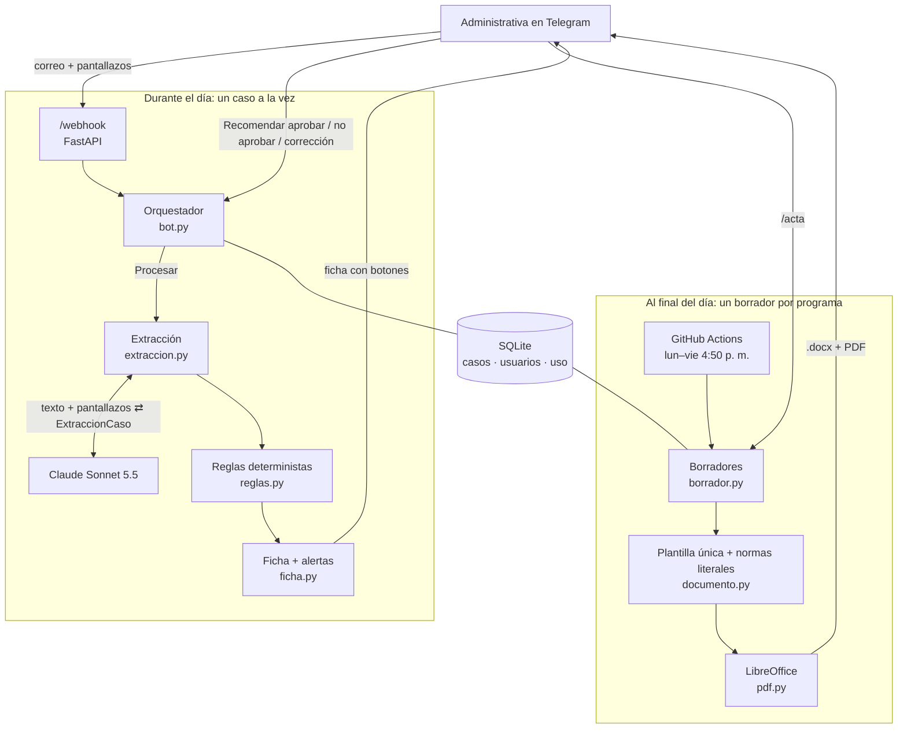
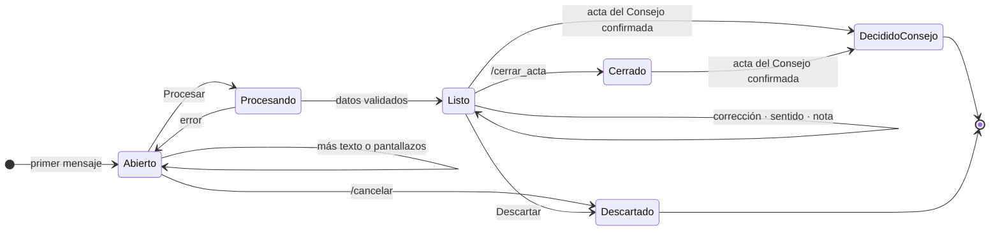

# fcen_bot

Agente de Telegram ([@fcenpregrado_bot](https://t.me/fcenpregrado_bot)) que ayuda a las administrativas de las direcciones de área curricular de la Facultad de Ciencias Exactas y Naturales (UNAL Manizales) a preparar los casos estudiantiles de los comités asesores.

Ellas pegan el correo del estudiante y los pantallazos del SIA. El bot lee el caso, responde con una ficha que trae alertas y entrega cada día, por programa, dos documentos en .docx y PDF: el **oficio** al Consejo de Facultad, que lleva solo la recomendación del comité, y el **acta** del comité, que además trae la sesión (fecha, hora, lugar, asistentes, orden del día) y el concepto de cada profesor. Todos los programas usan la misma plantilla membreteada.

**Principio:** el modelo lee y redacta; las reglas verifican; el comité recomienda y el Consejo de Facultad decide. El sentido de cada recomendación (aprobar o no aprobar) nunca sale del modelo: lo registra la administrativa con un botón.

## Flujo

1. **Registro.** Cada administrativa escanea su QR de invitación (`scripts/qr_invitacion.py`) y elige su dirección: Ciencias Naturales (Ing. Física, Ing. Biológica) o Matemáticas y Estadística (Matemáticas, Ciencias de la Computación, Estadística). Nadie más puede usar el bot.
2. **Caso.** Pega el correo (en uno o varios mensajes) o envía el formato de solicitud diligenciado (PDF o Word), y los pantallazos. El formato se reconoce por su título («FORMATO DE …») y se lee sin el modelo; si es un PDF escaneado, un botón pregunta si es el formato y, si lo es, sus páginas entran como pantallazos. Los demás PDF (certificados, soportes médicos) solo se registran por nombre: no se guardan ni se envían al modelo.
3. **Procesar.** Con el botón o con `/listo`, Claude lee el texto y las imágenes y devuelve datos estructurados. El bot responde la ficha: estudiante, documento, programa (reconocido por el código del plan en el pantallazo), tipo de solicitud, créditos, P.A.P.A., avance, normas base y alertas.
4. **Corregir.** Basta responder a la ficha con el cambio, por ejemplo «el documento es 1053…». Solo se corrige lo que se pide.
5. **Comité.** Botones: Recomendar aprobar, Recomendar no aprobar, Pendiente, Nota y **Concepto**. Con Concepto se elige el profesor (los integrantes de cada comité están en `app/core/programas.py`, o «Otro miembro») y se responde con su concepto tal como lo envió; va al acta, nunca al oficio. Responder «borrar» lo quita.
6. **Borrador.** Cada día hábil a las 4:50 p. m. llegan el oficio y el acta de cada programa que haya cambiado. También se pueden pedir con `/acta`. Lo que el comité completa en Word (número de acta, hora, lugar, quórum, varios) y los casos pendientes (`[APROBAR / NO APROBAR]`) salen resaltados en amarillo.
7. **Cierre.** `/cerrar_acta` saca del borrador los casos que ya tienen recomendación del comité.
8. **Acta del Consejo.** Con `/acta_consejo` (o en la web, pantalla «Acta del Consejo», roles administrativa y admin) se sube el acta del Consejo de Facultad, de Sede o Superior (PDF con texto o Word). Claude copia cada decisión con su texto literal y los identificadores que aparezcan; cada fragmento se comprueba contra el acta. El sentido (aprobó, no aprobó, aplazó, otro) sale del texto literal con una regla fija, y el cruce con los casos es determinista: número de caso, documento y nombre. Lo que no cruza con certeza queda en duda para asignarlo a mano o descartarlo. Nada se registra hasta que una persona confirma. Con `AVISO_CONSEJO_TELEGRAM=true` las personas del área reciben la decisión por Telegram.

## Arquitectura



Quién hace qué:

| Pieza | Hace | Usa el modelo |
|---|---|---|
| Extracción | Lee el correo y los pantallazos y los convierte en datos | Sí |
| Corrección | Aplica a los datos el cambio que pide la administrativa | Sí |
| Reglas | Verifican sumas del SIA, carga mínima, semanas, créditos de TdG y documento | No |
| Ficha | Muestra los datos y las alertas | No |
| Sentido de la recomendación | Lo marca la administrativa con un botón | No |
| Borrador | Arma el oficio con la plantilla y las normas literales | No |

### Ciclo de un caso



Los casos en **Listo** son los que forman el borrador del día de su programa.

### Estructura

- `app/api/routes.py`: webhook de Telegram, ruta interna del cron y `/health`.
- `app/services/`: un módulo por capacidad (`bot`, `extraccion`, `reglas`, `ficha`, `documento`, `pdf`, `borrador`).
- `app/integrations/`: solo entrada y salida (Telegram y Claude).
- `app/prompts/`: todas las instrucciones del modelo, en un solo lugar.
- `app/schemas/`: contratos Pydantic, entre ellos `ExtraccionCaso`, que es lo único que devuelve el modelo.
- `app/normativa/`: normas base con texto literal.
- `app/core/programas.py`: programas, direcciones, códigos de plan y correos.
- `app/templates/oficio_base.docx`: la plantilla membreteada con los estilos `FCEN …`.
- `app/db/`: SQL explícito y migraciones idempotentes. SQLite por defecto; Postgres con `DATABASE_URL` (`app/core/conexion.py`, docs/base-de-datos.md).

## Alertas deterministas (`app/services/reglas.py`)

| Regla | Fuente |
|---|---|
| Sumas de la tabla «Resumen de créditos» (TOTAL, TOTAL ESTUDIANTE, pendientes = exigidos − aprobados): detecta una mala lectura del pantallazo | Estructura del SIA |
| Carga mínima de 10 créditos después de la solicitud | Acuerdo 008 de 2008, art. 10 |
| Semana límite: asignaturas hasta la 10; Trabajo de Grado, práctica o pasantía y actividades hasta la 13 | Acuerdo 027 de 2024 |
| Traslado antes de la semana 7 | Acuerdo 089 de 2014, art. 2 |
| Trabajo de Grado en Ing. Física: 46 créditos disciplinares aprobados | Res. CFCEN-060-2008, art. 5 |
| Documento ausente, con caracteres raros o con un número inusual de dígitos | — |
| Cita del oficio: el fragmento entre comillas tiene que ser una subcadena exacta del correo, del formato o de la transcripción; si no, error y la cita sale en amarillo | Texto original del estudiante |
| Jurados de Trabajo de Grado: mínimo 6 (la variable `JURADOS_MINIMO`, si está definida, gana al YAML), y la frase de la solicitud no dice que el estudiante los «propone» o «sugiere» | Instrucción del Consejo de Facultad, 28-oct-2026 (no es norma) |

Los umbrales de la tabla y la instancia que decide cada trámite están en `config/solicitudes.yaml`, que edita la Vicedecanatura Académica sin tocar el código (`docs/solicitudes.md`). El comité asesor recomienda; decide el Consejo de Facultad, el de Sede o el Superior, según el trámite. Si el archivo falta o tiene un error, el servicio de actas no arranca.

Las normas que se citan en el oficio están en `app/normativa/base.py`, con su texto literal. Las marcadas `verificada=False` se copiaron de como aparecen en un acta, porque el PDF de la norma todavía no está en la carpeta de reglamentación.

## Comandos

`/nuevo` · `/listo` · `/cancelar` · `/casos` · `/caso N` · `/acta` · `/cerrar_acta` · `/acta_consejo` · `/costo` · `/ayuda`

Para la decanatura (ids en `DECANATURA_TELEGRAM_IDS`): `/resumen`, con cifras por programa y estado, sin nombres. También llega solo cada lunes a las 7:30 a. m.; se apaga con `RESUMEN_SEMANAL_ACTIVO=false`. Ver `docs/despliegue-servicios.md` §7.

Para la decanatura y los administradores (`ADMIN_TELEGRAM_IDS`): `/indicadores [periodo]`, con casos recibidos, recomendados, decididos por el Consejo y pendientes de acta, y los días de la solicitud a la recomendación y de la recomendación al Consejo (mediana y percentil 90), más el Excel con la pestaña «fuentes». En la web, la pantalla «Indicadores» muestra lo mismo: toda la Facultad a la decanatura y al admin, y su área a cada administrativa. Con `REPORTE_MENSUAL_ACTIVO=true` (apagado por defecto), el día 1 de cada mes a las 7:30 a. m. cada área recibe sus cifras y la Vicedecanatura el consolidado. Definiciones: `docs/indicadores.md`.

## Puesta en marcha

1. **Créditos de la API.** En claude.ai, ve a Settings → Billing → API credits y vincula una organización de la Console (el plan Max 5x trae 100 USD al mes). Luego crea una API key en la Console.
2. **Railway.** Crea un proyecto desde este repo, agrega un volumen montado en `/data` y define las variables de `.env.example`. Las obligatorias son `TELEGRAM_BOT_TOKEN`, `TELEGRAM_WEBHOOK_SECRET`, `INVITE_CODE` (solo letras, números, `_` o `-`), `ANTHROPIC_API_KEY`, `INTERNAL_CRON_SECRET` y `PERIODO_INICIO` (primer día de clases, `AAAA-MM-DD`).
3. **Webhook.** `uv run python scripts/set_webhook.py https://<app>.up.railway.app`
4. **Cron.** En el repo, ve a Settings → Secrets → Actions y crea `APP_URL` e `INTERNAL_CRON_SECRET`.
5. **QR.** `uv run python scripts/qr_invitacion.py fcenpregrado_bot`, uno para cada administrativa.
6. Comprueba que `GET /health` responda con `modelo_configurado: true`.

Para un PDF con la tipografía institucional, copia los `.ttf` de Ancízar Sans en `fonts/`; no se versionan.

## Formato único de oficio y acta

Ambos documentos usan la misma plantilla membreteada para los cinco programas y toman lo mejor de las actas de Física y de Ciencias de la Computación:

| Parte | Se toma de | Cómo queda |
|---|---|---|
| Encabezado del acta | CC | Fecha, hora, lugar, asistentes con su cargo, invitados |
| Orden del día | CC + Física | 1. Quórum · 2. Casos, con los estudiantes por sección (Física) · 3. Varios |
| Orden del caso | Consejo de Facultad (28-oct-2026) | Oficio: recomendación primero (con el número del caso), luego la solicitud, el análisis y las normas. Acta: solicitud, análisis, conceptos y recomendación, como transcurre la sesión |
| Caso | CC | «NOMBRE identificado con DNI No. … mediante correo (o formato) del día …, solicita …, justificando que “…”», con la cita en el mismo párrafo. La cita es el fragmento literal de la justificación, verificado contra el texto original |
| ANÁLISIS | Física | Plan, convocatoria, créditos inscritos y después de la solicitud, disciplinares, P.A.P.A., avance, semana, anexos |
| Pantallazos del SIA | — | No van en el .docx (§5.4): solo alimentan la extracción; el análisis escrito queda |
| Conceptos (solo acta) | CC | «El profesor X expresa: “…”», texto literal |
| Recomendación | Física | «El Comité Asesor recomienda al Consejo de Facultad APROBAR la solicitud de … a la estudiante …» |
| Jurados | Consejo de Facultad (28-oct-2026) | «Se recomiendan los siguientes jurados:» y tabla Nombre, Vinculación o institución, Correo, tal como los trae la solicitud |
| Asignaturas | §5.4 | Un párrafo por trámite («Inscribir/Cancelar las siguientes asignaturas:») y tabla Código, Asignatura, Grupo, Tipología, Créditos; sin grupo, celda en amarillo. ZAPC va en la frase de la recomendación |
| Normas | Física | «Basados en la normativa»: el oficio cita nombre, número y artículo; el acta trae el texto literal |

## Documentos

- `docs/diseno.md`: diseño, decisiones, estado actual y lo que sigue.
- `docs/inventario-insumos.md`: lo que entregó la Facultad (actas, oficios, normativa) y las reglas que se derivan de ahí.

## Desarrollo

```bash
make install
make test        # pruebas
make lint        # ruff
make typecheck   # mypy estricto
make demo        # borrador con casos ficticios en out/
uv run python scripts/probar_caso.py casos_reales/caso_01   # un caso real, con la API
```

`casos_reales/` está en `.gitignore`. Los casos con datos de estudiantes nunca van al repositorio.

### Evaluación con casos reales

```bash
uv run python scripts/evaluar.py casos_reales/              # todos
uv run python scripts/evaluar.py casos_reales/ --solo fis20 # solo los que empiezan así
```

Cada subcarpeta de `casos_reales/` es un caso sacado de un acta ya enviada: `correo.txt` (lo que pegaría la administrativa; vacío si el correo llegó como pantallazo), los pantallazos y `esperado.json` con lo que dice el acta. El script pasa cada caso por la misma extracción y las mismas reglas del bot y compara nombre, documento, trato, fecha, programa, tipos, créditos inscritos y después de la solicitud, créditos disciplinares, P.A.P.A., avance, códigos de las asignaturas, cuerpo del correo sin encabezados, sumas de la tabla del SIA y que no se repitan datos sensibles. Imprime una tabla (✓, ✗ o · si el acta no trae el dato), los fallos y el costo, y deja `_extraccion.json` en cada caso y `_resultados.json` en la raíz. Con 32 casos cuesta alrededor de 1 USD.

La plantilla `app/templates/oficio_base.docx` se generó con `scripts/build_template.py` a partir de un oficio del Comité Asesor de Ciencias de la Computación. El formato copia el de ese oficio (Ancízar Sans 11 pt, interlineado 1,15, sangría francesa en cada caso, la cita del correo en el mismo párrafo) en estilos con nombre: `FCEN Caso`, `FCEN Cita`, `FCEN Titulo`, etc. Si se cambia uno de esos estilos en Word, en la plantilla, cambian todos los oficios. Del original solo se conserva el membrete; el script borra el cuerpo, las imágenes y las fuentes embebidas, y comprueba que no quede ningún dato de estudiantes.

## Costos

Sonnet 5.5 cuesta 2 USD por millón de tokens de entrada y 10 USD por millón de salida. Un caso con correo y 2–3 pantallazos sale en unos 0,03 USD; `/costo` muestra el consumo real del mes. A eso se suma el hosting en Railway.

## Datos personales

Las solicitudes traen documentos de identidad, situaciones económicas y a veces información de salud. Por eso:
- Solo las personas registradas con el código pueden usar el bot.
- Al modelo se le pide describir los soportes de forma genérica y no copiar diagnósticos.
- Los PDF adjuntos no se envían al modelo.

Pendiente: definir con la Facultad el plazo de retención de imágenes y la autorización del tratamiento de datos (Ley 1581 de 2012).

## Fases

1. **Hecha:** lectura de casos, ficha con alertas, plantilla única y borrador diario.
2. Índice de la normativa completa (por artículo, con vigencias) y citas verificadas contra la fuente.
3. Firma (imagen del firmante por programa, radicado confirmado, registro de quién firmó) y datos de la sesión capturados en el bot.
4. Google Drive institucional, si DNTIC autoriza la app.
