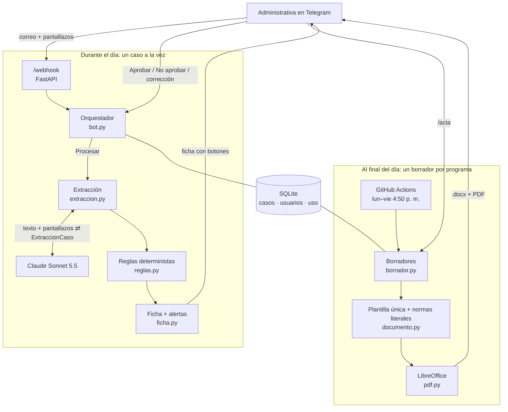
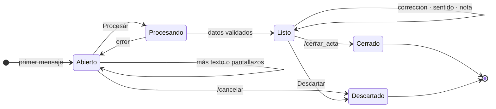

# fcen_bot

Agente de Telegram ([@fcenpregrado_bot](https://t.me/fcenpregrado_bot)) que ayuda a las administrativas de las direcciones de área curricular de la Facultad de Ciencias Exactas y Naturales (UNAL Manizales) a preparar los casos estudiantiles de los comités asesores.

Ellas pegan el correo del estudiante y los pantallazos del SIA. El bot lee el caso, responde con una ficha que trae alertas y entrega cada día el borrador del oficio al Consejo de Facultad, uno por programa, en .docx y PDF. Todos los programas usan la misma plantilla membreteada.

**Principio:** el modelo lee y redacta; las reglas verifican; el comité decide. El sentido de cada recomendación (aprobar o no aprobar) nunca sale del modelo: lo registra la administrativa con un botón.

## Flujo

1. **Registro.** Cada administrativa escanea su QR de invitación (`scripts/qr_invitacion.py`) y elige su dirección: Ciencias Naturales (Ing. Física, Ing. Biológica) o Matemáticas y Estadística (Matemáticas, Ciencias de la Computación, Estadística). Nadie más puede usar el bot.
2. **Caso.** Pega el correo (en uno o varios mensajes) y envía los pantallazos. Los PDF adjuntos solo se registran por nombre: no se descargan ni se envían al modelo.
3. **Procesar.** Con el botón o con `/listo`, Claude lee el texto y las imágenes y devuelve datos estructurados. El bot responde la ficha: estudiante, documento, programa (reconocido por el código del plan en el pantallazo), tipo de solicitud, créditos, P.A.P.A., avance, normas base y alertas.
4. **Corregir.** Basta responder a la ficha con el cambio, por ejemplo «el documento es 1053…». Solo se corrige lo que se pide.
5. **Comité.** Botones: Aprobar, No aprobar, Pendiente, y «Nota del comité».
6. **Borrador.** Cada día hábil a las 4:50 p. m. llega el borrador de cada programa que haya cambiado. También se puede pedir con `/acta`. Los casos pendientes salen resaltados como `[APROBAR / NO APROBAR]`.
7. **Cierre.** `/cerrar_acta` saca del borrador los casos que ya tienen decisión del comité.

## Arquitectura



Quién hace qué:

| Pieza | Hace | Usa el modelo |
|---|---|---|
| Extracción | Lee el correo y los pantallazos y los convierte en datos | Sí |
| Corrección | Aplica a los datos el cambio que pide la administrativa | Sí |
| Reglas | Verifican sumas del SIA, carga mínima, semanas, créditos de TdG y documento | No |
| Ficha | Muestra los datos y las alertas | No |
| Sentido de la recomendación | Lo marca la administrativa con un botón | No |
| Borrador | Arma el oficio con la plantilla y las normas literales | No |

### Ciclo de un caso



Los casos en **Listo** son los que forman el borrador del día de su programa.

### Estructura

- `app/api/routes.py`: webhook de Telegram, ruta interna del cron y `/health`.
- `app/services/`: un módulo por capacidad (`bot`, `extraccion`, `reglas`, `ficha`, `documento`, `pdf`, `borrador`).
- `app/integrations/`: solo entrada y salida (Telegram y Claude).
- `app/prompts/`: todas las instrucciones del modelo, en un solo lugar.
- `app/schemas/`: contratos Pydantic, entre ellos `ExtraccionCaso`, que es lo único que devuelve el modelo.
- `app/normativa/`: normas base con texto literal.
- `app/core/programas.py`: programas, direcciones, códigos de plan y correos.
- `app/templates/oficio_base.docx`: la plantilla membreteada con los estilos `FCEN …`.
- `app/db/`: SQLite con SQL explícito y migraciones idempotentes.

## Alertas deterministas (`app/services/reglas.py`)

| Regla | Fuente |
|---|---|
| Sumas de la tabla «Resumen de créditos» (TOTAL, TOTAL ESTUDIANTE, pendientes = exigidos − aprobados): detecta una mala lectura del pantallazo | Estructura del SIA |
| Carga mínima de 10 créditos después de la solicitud | Acuerdo 008 de 2008, art. 10 |
| Semana límite: asignaturas hasta la 10; Trabajo de Grado, práctica o pasantía y actividades hasta la 13 | Acuerdo 027 de 2024 |
| Traslado antes de la semana 7 | Acuerdo 089 de 2014, art. 2 |
| Trabajo de Grado en Ing. Física: 46 créditos disciplinares aprobados | Res. CFCEN-060-2008, art. 5 |
| Documento ausente, con caracteres raros o con un número inusual de dígitos | — |

Las normas que se citan en el oficio están en `app/normativa/base.py`, con su texto literal. Las marcadas `verificada=False` se copiaron de como aparecen en un acta, porque el PDF de la norma todavía no está en la carpeta de reglamentación.

## Comandos

`/nuevo` · `/listo` · `/cancelar` · `/casos` · `/caso N` · `/acta` · `/cerrar_acta` · `/costo` · `/ayuda`

## Puesta en marcha

1. **Créditos de la API.** En claude.ai, ve a Settings → Billing → API credits y vincula una organización de la Console (el plan Max 5x trae 100 USD al mes). Luego crea una API key en la Console.
2. **Railway.** Crea un proyecto desde este repo, agrega un volumen montado en `/data` y define las variables de `.env.example`. Las obligatorias son `TELEGRAM_BOT_TOKEN`, `TELEGRAM_WEBHOOK_SECRET`, `INVITE_CODE` (solo letras, números, `_` o `-`), `ANTHROPIC_API_KEY`, `INTERNAL_CRON_SECRET` y `PERIODO_INICIO` (primer día de clases, `AAAA-MM-DD`).
3. **Webhook.** `uv run python scripts/set_webhook.py https://<app>.up.railway.app`
4. **Cron.** En el repo, ve a Settings → Secrets → Actions y crea `APP_URL` e `INTERNAL_CRON_SECRET`.
5. **QR.** `uv run python scripts/qr_invitacion.py fcenpregrado_bot`, uno para cada administrativa.
6. Comprueba que `GET /health` responda con `modelo_configurado: true`.

Para un PDF con la tipografía institucional, copia los `.ttf` de Ancízar Sans en `fonts/`; no se versionan.

## Documentos

- `docs/diseno.md`: diseño, decisiones, estado actual y lo que sigue.
- `docs/inventario-insumos.md`: lo que entregó la Facultad (actas, oficios, normativa) y las reglas que se derivan de ahí.

## Desarrollo

```bash
make install
make test        # pruebas
make lint        # ruff
make typecheck   # mypy estricto
make demo        # borrador con casos ficticios en out/
uv run python scripts/probar_caso.py casos_reales/caso_01   # un caso real, con la API
```

`casos_reales/` está en `.gitignore`. Los casos con datos de estudiantes nunca van al repositorio.

La plantilla `app/templates/oficio_base.docx` se generó con `scripts/build_template.py` a partir de un oficio del Comité Asesor de Ciencias de la Computación. El formato copia el de ese oficio (Ancízar Sans 11 pt, interlineado 1,15, sangría francesa en cada caso, la cita del correo en el mismo párrafo) en estilos con nombre: `FCEN Caso`, `FCEN Cita`, `FCEN Titulo`, etc. Si se cambia uno de esos estilos en Word, en la plantilla, cambian todos los oficios. Del original solo se conserva el membrete; el script borra el cuerpo, las imágenes y las fuentes embebidas, y comprueba que no quede ningún dato de estudiantes.

## Costos

Sonnet 5.5 cuesta 2 USD por millón de tokens de entrada y 10 USD por millón de salida. Un caso con correo y 2–3 pantallazos sale en unos 0,03 USD; `/costo` muestra el consumo real del mes. A eso se suma el hosting en Railway.

## Datos personales

Las solicitudes traen documentos de identidad, situaciones económicas y a veces información de salud. Por eso:
- Solo las personas registradas con el código pueden usar el bot.
- Al modelo se le pide describir los soportes de forma genérica y no copiar diagnósticos.
- Los PDF adjuntos no se envían al modelo.

Pendiente: definir con la Facultad el plazo de retención de imágenes y la autorización del tratamiento de datos (Ley 1581 de 2012).

## Fases

1. **Hecha:** lectura de casos, ficha con alertas, plantilla única y borrador diario.
2. Índice de la normativa completa (por artículo, con vigencias) y citas verificadas contra la fuente.
3. Firma (imagen del firmante por programa, radicado confirmado, registro de quién firmó) y acta interna con los conceptos de los profesores.
4. Google Drive institucional, si DNTIC autoriza la app.
