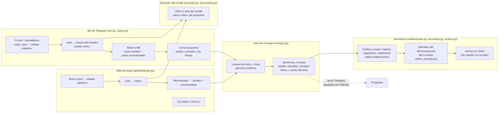
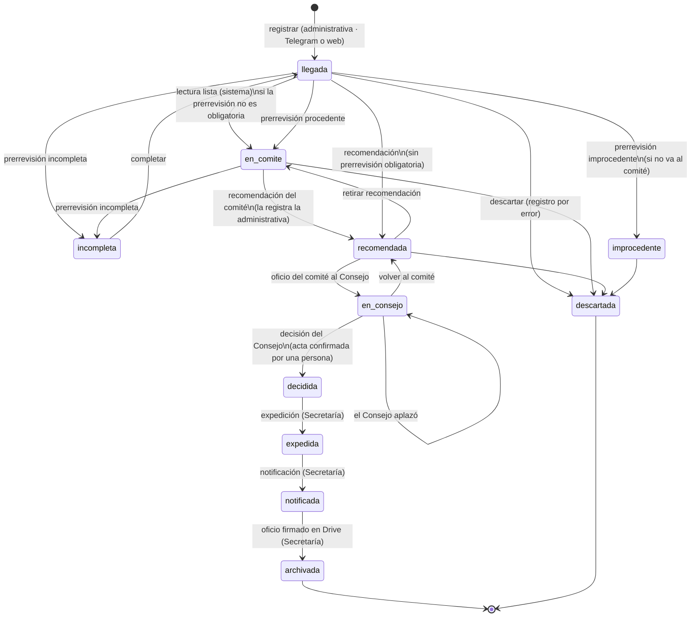

# Flujo de una solicitud estudiantil (servicio de actas)

Una solicitud tiene **una sola ficha** (`casos`) y **una sola línea de
estados** (`casos.etapa` y su historia en `caso_eventos`), desde que llega
hasta que se archiva, sin importar si entró por Telegram o por la web.

- Código: `app/services/flujo.py` (máquina de estados y operaciones).
- Configuración de negocio: `config/solicitudes.yaml`, sección `flujo`
  (`docs/solicitudes.md`).
- Pruebas: `tests/test_flujo.py`.

Reglas que no cambian (AGENTS.md): el modelo extrae y redacta, pero nunca hace
una transición; el comité asesor **nunca aprueba**, solo recomienda APROBAR o
NO APROBAR; decide el Consejo de Facultad, de Sede o Superior.

## 1. Antes: el mapa de lo que existía

Hasta esta versión el recorrido estaba repartido en cinco piezas que no
compartían un estado común.

| Paso | Dónde vive | Estado que dejaba | Fecha que registraba | Duplicación o hueco |
|---|---|---|---|---|
| Llegada | `bot.py` (`crear_caso`) y `api/web/actas.py` (`POST /casos`) | `estado=abierto` | `casos.creado` | Sin registro de quién la creó ni por qué canal. |
| Prerrevisión del programa | — | — | — | **No existía.** Un caso improcedente solo se podía «descartar», y el descarte lo saca de las métricas. |
| Lectura (modelo) | `casos.py` (`procesar`) | `procesando` → `listo` o `error` | — | Es un estado técnico, mezclado con el estado del trámite. |
| En comité | implícito: casos `listo` del borrador (`repo.casos_listos`) | `listo` | — | No había un momento registrado de «entra al comité». |
| Recomendación del comité | botón en Telegram (`s:`) y en la web (`/recomendacion`) | `casos.sentido` | `casos.recomendado` | Se podía cambiar aun después de que el Consejo decidiera (el sentido cambiaba, la fecha no). |
| Oficio del comité al Consejo | Telegram «Cerrar programa» (`cerrar_casos`) | `estado=cerrado` | **ninguna** (solo `actualizado`, que cambia con cualquier edición) | **La web no tenía este paso:** un caso trabajado solo en la web se quedaba en `listo` (y en el borrador) para siempre. Estados distintos entre Telegram y la web. |
| Decisión del Consejo | `consejo.py` (`aplicar`), Telegram y web | `decisiones_consejo` + `estado=decidido_consejo` (aplazado: sin cambio de estado) | `acta_fecha` (sesión) y `confirmado` | Se podía reemplazar una decisión ya expedida por la Secretaría. Decisiones de Sede o Superior no tenían siguiente paso. |
| Expedición | `notificaciones.py` (`PUT /secretaria/notificaciones/{id}`) | ninguno: solo fechas en `notificaciones` | `fecha_expedicion` (a mano) | La «fecha de ingreso a la Secretaría» se pide aparte y se sugiere con la de la recomendación (otro dato distinto al que ya está en el acta). |
| Notificación | ídem | ninguno | `fecha_notificacion` (a mano) | Sin estado: el caso «decidido» se veía igual notificado o no. |
| Archivo en Drive | `api/web/archivo.py` | ninguno | ninguna en la base | Solo Drive sabía si el oficio firmado estaba archivado. |
| Aviso al programa | `consejo.avisar` | — | — | Apagado por defecto (`AVISO_CONSEJO_TELEGRAM`); no queda registro. |
| Indicadores, SUIT, estadísticas | `indicadores.py`, `suit.py`, `estadisticas_consejo.py` | leen `sentido`, `recomendado`, `decisiones_consejo` | — | Cada pantalla calculaba «en qué va el caso» a su manera: la lista de la web por `estado`, `/casos` por `estado` + `sentido`, el tablero por `estado` + `sentido`. |

## 2. Después: la línea única

### Transiciones y quién las hace

| Acción | Desde | Hacia | Rol | Telegram | Web |
|---|---|---|---|---|---|
| `registrar` | — | llegada | administrativa (sistema en práctica) | correo o foto nuevos | Nuevo caso |
| `lectura_lista` | llegada | en_comite | sistema (solo si `prerrevision_obligatoria: false`) | `/listo` | Leer el caso |
| `prerrevisar_procedente` | llegada, incompleta, en_comite | en_comite | administrativa | botón «Procedente» | Prerrevisión: procedente |
| `prerrevisar_improcedente` | llegada, incompleta, en_comite | en_comite o improcedente (según `improcedente_va_a_comite`) | administrativa | «Improcedente» | Prerrevisión: improcedente |
| `prerrevisar_incompleto` | llegada, en_comite | incompleta | administrativa | «Incompleta» | Prerrevisión: incompleta |
| `completar` | incompleta | llegada | administrativa | — | Ya llegó lo que faltaba |
| `recomendar` | en_comite, recomendada (y llegada sin prerrevisión obligatoria) | recomendada | administrativa (registra lo que recomendó el comité) | ✅ / ❌ | Recomendar aprobar / no aprobar |
| `quitar_recomendacion` | recomendada | en_comite | administrativa | ⏳ Pendiente | Pendiente |
| `enviar_consejo` | recomendada | en_consejo | administrativa | Cerrar programa | **Enviar al Consejo (nuevo)** |
| `volver_al_comite` | en_consejo | recomendada | administrativa | — | Volver al comité |
| `aplazar` | llegada … en_consejo | en_consejo | administrativa, admin | Acta del Consejo | Acta del Consejo |
| `decidir` | llegada … en_consejo, decidida (reemplazo) | decidida | administrativa, admin | Acta del Consejo | Acta del Consejo |
| `expedir` | decidida | expedida | secretaria, admin | — | Notificaciones (número y fecha de expedición) |
| `notificar` | expedida | notificada | secretaria, admin | — | Notificaciones (fecha de notificación) |
| `anular_notificacion`, `anular_expedicion` | notificada, expedida | expedida, decidida | secretaria, admin | — | Notificaciones (corrige una fecha) |
| `archivar_documento` | expedida | expedida (solo anota) | secretaria, admin | — | Archivar oficio firmado |
| `archivar` | notificada | archivada | secretaria, admin | — | Archivar oficio firmado (o al notificar, si ya estaba en Drive) |
| `descartar` | llegada, incompleta, improcedente, en_comite, recomendada | descartada | administrativa | `/cancelar`, 🗑 | — |

- **El rol `comite` no tiene ninguna transición.** El comité deja su concepto
  y recomienda en su sesión; la administrativa lo registra. `tests/test_flujo.py`
  falla si el comité puede «aprobar» o llegar a `decidida`.
- La decisión sale del acta del Consejo, que manda sobre la línea: se registra
  aunque falte un paso previo en MemorIA (queda a la vista en la historia).
- Cada transición guarda en `caso_eventos`: acción, etapa de origen y destino,
  **fecha del hecho** (`fecha`: la sesión del acta para la decisión, las
  fechas que registra la Secretaría para expedición y notificación; ahora para
  lo demás), rol, persona, canal (`telegram`, `web`, `sistema`, `migracion`,
  `practica`), detalle y cuándo se registró (`registrado`).

### Dónde se ve

- **Ficha del caso (web):** sección «Línea del caso» con la etapa, el
  siguiente paso y su responsable, la historia completa y los días por tramo
  (de la llegada a la decisión, a la recomendación, de la recomendación a la
  decisión y de la decisión a la notificación).
- **Lista de casos (web) y `/casos` (Telegram):** la etapa de la línea.
- **Indicadores:** las cifras de siempre más el indicador principal
  (`dias_total_*`: días de la solicitud a la decisión del Consejo) e
  `improcedentes`. Ver `docs/indicadores.md`.

### Qué leen los indicadores, el SUIT y las estadísticas

`casos.recomendado`, `decisiones_consejo` y `notificaciones` se mantienen como
las columnas que ya leían los indicadores, el SUIT, las estadísticas y la
pantalla de Notificaciones, pero ahora **solo se escriben a través de la
línea**: la fecha del evento `recomendar` es la misma de `casos.recomendado`,
la del evento `decidir` es la `acta_fecha`, y las de `expedir` y `notificar`
son las de `notificaciones`. `tests/test_flujo.py` verifica que coincidan. Por
eso los números no cambian.

## 3. Migración

`app/db/session.py` crea `caso_eventos` y las columnas `casos.etapa` y
`casos.prerrevision` (`CREATE TABLE IF NOT EXISTS` y `ADD COLUMN` si falta; el
mismo SQL en SQLite y en Postgres). Luego `flujo.migrar` da etapa e historia a
los casos que no la tienen:

- solo toca filas con `etapa IS NULL`, en la misma transacción que la marca:
  correrla dos veces no duplica nada;
- deduce la etapa de lo guardado (`estado`, `sentido`, `decisiones_consejo`,
  `notificaciones`) y conserva las fechas que existían (`creado`,
  `recomendado`, `acta_fecha`, fechas de la Secretaría);
- **no inventa fechas**: lo que no tenía fecha (p. ej., cuándo se cerró un
  programa en Telegram) queda con `fecha` vacía y canal `migracion`;
- si un caso se escribe por fuera de la línea (una prueba, un script), su etapa
  se deriva la primera vez que se lee.

`scripts/migrar_sqlite_a_postgres.py` copia todas las tablas, así que también
copia `caso_eventos`.

## 4. Cambios de comportamiento (correcciones)

- **La web tiene «Enviar al Consejo».** Antes solo Telegram cerraba los casos.
- **En el Consejo, la recomendación ya no se cambia con el botón.** Hay que
  «Volver al comité» primero (queda registrado y el caso vuelve al borrador).
  Antes se podía cambiar el sentido incluso después de la decisión del Consejo.
- **Descartar** solo se puede antes de enviar el caso al Consejo. Para una
  solicitud que no procede está la prerrevisión «improcedente», que sí cuenta en
  las métricas.
- **Con el acto expedido, la decisión del Consejo no se reemplaza** en MemorIA.
- Los casos marcados incompletos (o improcedentes que no van al comité) salen
  del borrador del comité.

## 5. Pendientes de negocio (configurables, con el valor actual)

| Pregunta | Dónde | Valor actual |
|---|---|---|
| ¿La prerrevisión es obligatoria antes del comité? | `config/solicitudes.yaml` → `flujo.prerrevision_obligatoria` | `false` (como antes: todo caso leído va al comité) |
| ¿Las improcedentes pasan por el comité? | `flujo.improcedente_va_a_comite` | `true` (como antes: todo pasa por el comité) |
| ¿Quién decide cada trámite (Trabajo de Grado, jurados, cancelación…)? | `solicitudes.<tipo>.decide` | `por_confirmar` salvo carga mínima, inscripción extemporánea y PAE |
| ¿Quién expide y notifica cuando decide el Consejo de Sede o el Superior? | — | Sin definir: la ficha lo dice como siguiente paso «por definir» |
| ¿Quién y cómo notifica al estudiante una improcedente que no va al comité? | — | Sin definir |
| ¿Una solicitud incompleta detiene el reloj del indicador? | `indicadores.py` | No: los días cuentan desde la fecha de la solicitud |
| ¿La «fecha de ingreso a la Secretaría» puede salir de la línea (decisión) en vez de pedirse a mano? | `notificaciones.py` | Se sigue pidiendo a mano; se sugiere la de la recomendación |
| ¿El rol `comite` debe registrar la recomendación en la web, o solo la administrativa? | `flujo.transiciones` | Solo la administrativa (como antes) |
| ¿Se activa el aviso de la decisión a los programas por Telegram? | `AVISO_CONSEJO_TELEGRAM` | Apagado |
| ¿Cómo entra a la línea un recurso de reposición o apelación? | — | No se modela todavía |
